<p align="center">
  
</p>

<h1 align="center">Life Dashboard Companion</h1>

<p align="center">
  <b>Health Connect and screen time from your Android phone, sent to Home Assistant, MQTT or your own server.</b><br>
  Every source app at once, with no account and no Google account in between.
</p>

<p align="center">
  <a href="https://play.google.com/store/apps/details?id=com.owen282000.lifedashboard&referrer=utm_source%3Dgh-android-readme%26utm_medium%3Dreadme"></a><br>
  <sub>€4.99 (US$4.99) once. No subscription, no in-app purchases. Same code as this repo, or <a href="#install">get the APK</a> from GitHub or F&#8209;Droid.</sub>
</p>

<p align="center">
  <a href="https://github.com/owen282000/life-dashboard-companion-app/releases/latest"></a>
  <a href="https://my.home-assistant.io/redirect/hacs_repository/?owner=owen282000&repository=life-dashboard-ha&category=integration"></a>
  <a href="#install"></a>
  <a href="https://hosted.weblate.org/engage/life-dashboard-companion/"></a>
  <a href="https://www.bestpractices.dev/projects/14258"></a>
  <a href="LICENSE"></a>
</p>

<p align="center">
  <a href="#install"><b>Install</b></a>
  &nbsp;·&nbsp;
  <a href="docs/usage.md">Setup&nbsp;guide</a>
  &nbsp;·&nbsp;
  <a href="docs/brands/README.md">Brand&nbsp;guides</a>
  &nbsp;·&nbsp;
  <a href="docs/webhook.md">Payload&nbsp;reference</a>
  &nbsp;·&nbsp;
  <a href="https://owen282000.com/life-dashboard/android/">Website</a>
</p>

<p align="center">
  <sub>Life Dashboard: <b>Android app</b> &nbsp;·&nbsp; <a href="https://github.com/owen282000/life-dashboard-companion-app-ios">iPhone app</a> &nbsp;·&nbsp; <a href="https://github.com/owen282000/life-dashboard-ha">Home Assistant integration</a> &nbsp;·&nbsp; <a href="https://github.com/owen282000/life-dashboard-stack">Grafana stack</a> &nbsp;·&nbsp; <a href="https://github.com/owen282000/life-dashboard-sleep-card">Sleep card</a> &nbsp;·&nbsp; <a href="https://github.com/owen282000/life-dashboard-screen-time-card">Screen time cards</a></sub>
</p>

<p align="center">
  <picture>
    <source media="(max-width: 600px)" srcset="docs/readme-screens-phone.png">
    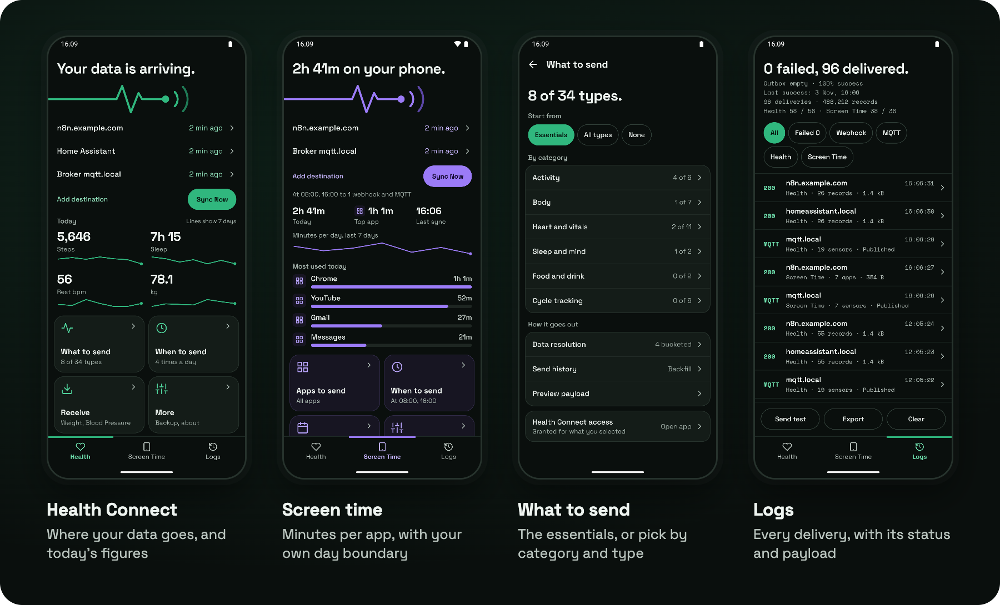
  </picture>
</p>

Your watch, ring or scale already writes to Health Connect. This app sends that data, from every source app at once, plus your screen time per app, to Home Assistant, an MQTT broker or a webhook you run. There is no account and no Google account in between, and none of it reaches me.

- Samsung Health, Fitbit, Garmin, Oura, Withings: if it writes to Health Connect, it arrives, with no cloud login and no developer app to register per brand. That includes Fitbit, now that Google switched off the Fitbit Web API on 2 November 2026.
- In Home Assistant all your history lands on the days it happened, paired with one QR code, and it stays when you change phones: the new phone can take over the old one's history.
- Edits and deletions go out too, not only new records, so your server stays in step with Health Connect.
- Day totals add up: steps, distance and calories are Health Connect's own figure for the day, so a walk recorded by both phone and watch counts once.
- An Android phone and an iPhone send the same payload, so a mixed household shares one Home Assistant integration or one database.
- Open source (MIT), with the same signing key on GitHub, F-Droid and Google Play.
- Want to ask Claude or a local model in Ollama about your own history? The [Grafana stack](https://github.com/owen282000/life-dashboard-stack#ask-your-own-ai-mcp) adds an MCP server with eight read-only tools. The app itself contains no AI.

<a id="why-this-app"></a>

## What you get

- **34 Health Connect types.** Steps, sleep with stages, heart rate and HRV, speed, weight and body composition, blood pressure, glucose, workouts, nutrition, cycle tracking and more. Each type has its own switch.
- **Every record, plus clean daily totals.** Every raw record goes out with the app that wrote it. Daily totals for steps, distance and calories come from Health Connect itself, so a walk recorded by both phone and watch counts once.
- **All your history.** Backfill from 30 days up to 5 years, or everything Health Connect has, in one go. In Home Assistant each day lands on its own date.
- **Screen time per app.** Foreground minutes for every app, with a day boundary you choose (say 04:00 for late nights) and a filter to leave apps out.
- **Back into Health Connect.** With **Receive** on, readings from a scale or blood pressure monitor in Home Assistant go into Health Connect. Samsung Health and Google Health pick up the weight and body fat from there. This needs the Life Dashboard integration.
- **Runs on its own.** An interval or fixed times, on the days you pick, with quiet hours, and nothing running in between. If your server is down or only reachable at home, payloads wait on the phone for the next sync that gets through.

Recipes to start from: a [bedtime reminder from your next alarm](docs/recipes/alarm-and-sleep.md), [screen time limits](docs/recipes/screen-time-limits.md), a [Bluetooth scale into Samsung Health](docs/recipes/scale-to-health-connect.md), and [asking a local LLM about your own history](docs/recipes/ask-your-own-llm.md).

On the other end, this is the Life Dashboard integration's [example dashboard](https://github.com/owen282000/life-dashboard-ha/blob/main/docs/dashboard.md) in Home Assistant, with a screen time view of its own (demo data):

<p align="center">
  <picture>
    <source media="(max-width: 600px)" srcset="docs/readme-hero-phone.png">
    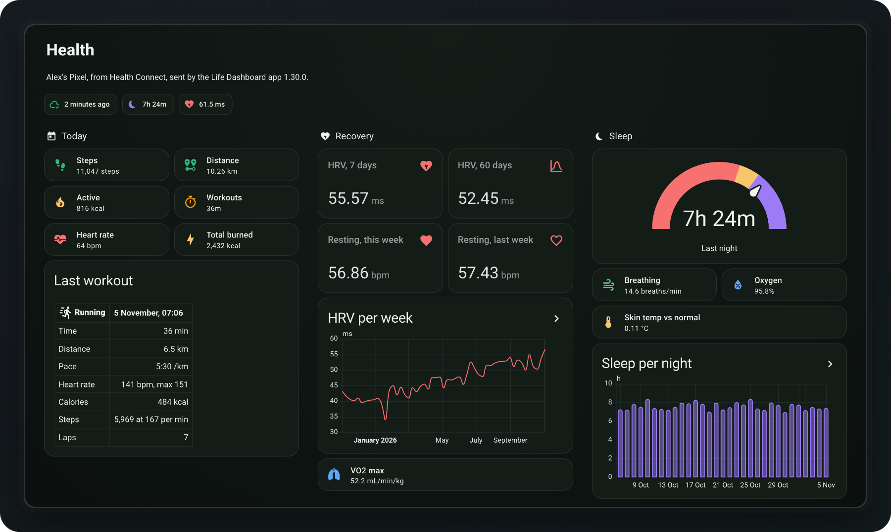
  </picture>
</p>

## How it works

Health Connect is the place on Android where fitness apps keep their data. Garmin Connect, Samsung Health, Fitbit, Oura, Withings and Gadgetbridge all write to it. This app reads from it on a schedule and sends the new records straight to the places you set up.

<p align="center">
  <picture>
    <source media="(max-width: 600px)" srcset="docs/how-it-works-phone.png">
    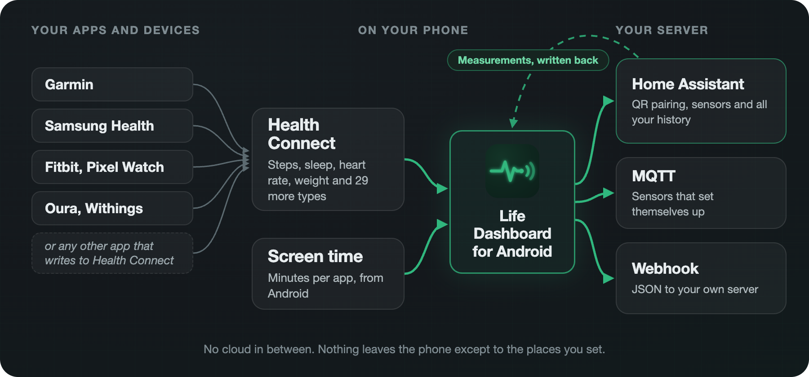
  </picture>
</p>

Not sure your watch is covered? The [brand guides](docs/brands/README.md) show what each one actually writes, and what it keeps to itself.

## Part of Life Dashboard

Life Dashboard is two apps, three places for the data to go and a set of cards for Home Assistant, and you only install the parts you need. Put the app on each phone, then pick where the data goes. Both apps send the same payload, so an Android phone and an iPhone can share one Home Assistant, one stack or one server of your own.

<p align="center">
  <b>On your phone</b><br>
  <picture><source media="(prefers-color-scheme: light)" srcset="docs/family/android-here-light.png">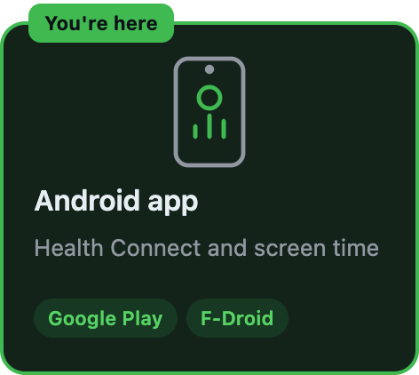</picture>
  <a href="https://github.com/owen282000/life-dashboard-companion-app-ios"><picture><source media="(prefers-color-scheme: light)" srcset="docs/family/ios-light.png">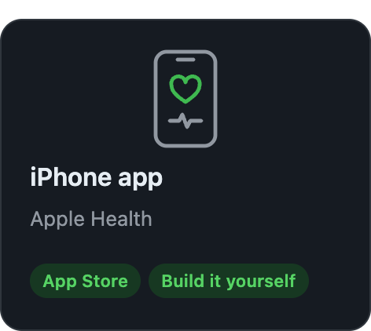</picture></a>
</p>

<p align="center">
  <picture><source media="(prefers-color-scheme: light)" srcset="docs/family/arrow-light.png"></picture><br>
  <sub>sends your data to</sub>
</p>

<p align="center">
  <b>Where the data goes</b><br>
  <a href="https://github.com/owen282000/life-dashboard-stack"><picture><source media="(prefers-color-scheme: light)" srcset="docs/family/stack-light.png"></picture></a>
  <a href="https://github.com/owen282000/life-dashboard-ha"><picture><source media="(prefers-color-scheme: light)" srcset="docs/family/ha-light.png"></picture></a>
  <a href="https://owen282000.com/life-dashboard/health-connect-webhook/"><picture><source media="(prefers-color-scheme: light)" srcset="docs/family/own-server-light.png"></picture></a>
</p>

<p align="center">
  <picture><source media="(prefers-color-scheme: light)" srcset="docs/family/arrow-light.png"></picture>
</p>

<p align="center">
  <b>Cards for your Home Assistant dashboard</b><br>
  <sub>They need Home Assistant; most work with any sensor, and the integration fills them with your history.</sub><br>
  <a href="https://github.com/owen282000/life-dashboard-sleep-card"><picture><source media="(prefers-color-scheme: light)" srcset="docs/family/sleep-card-light.png">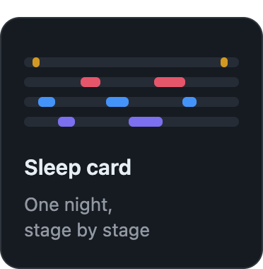</picture></a>
  <a href="https://github.com/owen282000/life-dashboard-screen-time-card"><picture><source media="(prefers-color-scheme: light)" srcset="docs/family/screen-time-card-light.png">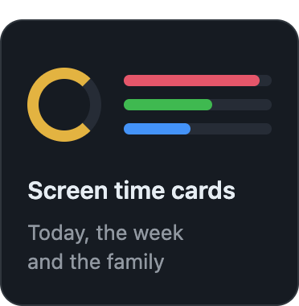</picture></a>
  <a href="https://github.com/owen282000/life-dashboard-year-card"><picture><source media="(prefers-color-scheme: light)" srcset="docs/family/year-card-light.png">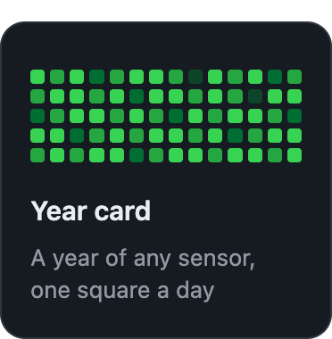</picture></a>
  <a href="https://github.com/owen282000/life-dashboard-activity-card"><picture><source media="(prefers-color-scheme: light)" srcset="docs/family/activity-card-light.png">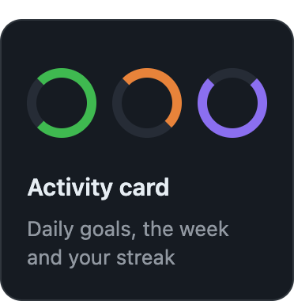</picture></a>
  <a href="https://github.com/owen282000/life-dashboard-before-bed-card"><picture><source media="(prefers-color-scheme: light)" srcset="docs/family/before-bed-card-light.png">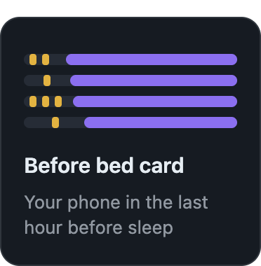</picture></a>
</p>

## Install

<p align="center">
  <a href="https://play.google.com/store/apps/details?id=com.owen282000.lifedashboard&referrer=utm_source%3Dgh-android-readme%26utm_medium%3Dreadme"></a>
</p>

Google Play is the easy way: updates arrive automatically, and buying the app supports development. It costs €4.99 (US$4.99) once, with no subscription.

Free, or build it yourself:

<p align="center">
  <a href="https://github.com/owen282000/life-dashboard-companion-app/releases/latest"></a>
  <a href="https://f-droid.org/packages/com.owen282000.lifedashboard/"></a>
  <a href="https://apps.obtainium.imranr.dev/redirect?r=obtainium://add/https://github.com/owen282000/life-dashboard-companion-app"></a>
  <a href="https://alternativeto.net/software/life-dashboard-companion/about/">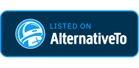</a>
</p>

The APK on GitHub is signed. Each release has build provenance that you can [verify](SECURITY.md#verifying-a-release), and the build is [reproducible](docs/building.md#reproduce-a-release-build). F&#8209;Droid builds each release on its own server and ships it only if the result matches this APK, so both have the same signature and you can switch between them. Obtainium installs the APK from GitHub and keeps it updated. These routes stay free, and they are the same app as on Google Play, signed with the same key. [building.md](docs/building.md) explains how to build it yourself.

Screen time works on Android 8.0 and newer. The health part needs Android 9 or newer with [Health Connect](https://developer.android.com/health-and-fitness/health-connect), which is built into Android 14 and later and comes from Google Play on Android 9 through 13.

## Quick start

1. In Home Assistant 2026.3 or newer, go to **Settings > Marketplace** ([HACS](https://hacs.xyz/docs/use/) before 2026.11), search for the [Life Dashboard integration](https://my.home-assistant.io/redirect/hacs_repository/?owner=owen282000&repository=life-dashboard-ha&category=integration) and install it. On HACS, restart Home Assistant. Add the integration if its setup doesn't open by itself. It shows a QR code. Skip this step if you use MQTT or a webhook.
2. Install the app and open it. Its setup asks where your data should go: scan the code, or enter your broker or webhook URL.
3. Grant the Health Connect permissions on the **Health** tab, and usage access on the **Screen Time** tab if you want screen time.
4. Tap **Sync Now**. **Preview payload** under **What to send** shows what it would send.

The [setup guide](docs/usage.md) walks through each step, including battery settings that keep Android from stopping the sync and what to do when nothing arrives.

## Home Assistant

There are two ways in. Neither needs YAML.

| | Life Dashboard integration | MQTT |
|---|---|---|
| Setup | Marketplace (HACS before 2026.11), then scan a QR code | Enter your broker |
| Sensors | 27 of 34 types, plus screen time in total and per app | 25 of 34 types, without the last workout, plus screen time in total |
| History | Every day, as far back as Health Connect has data, through backfill | From the first sync on |
| Sleep stages per night, and what you ate today | Yes | No |
| Workouts and mindfulness | Minutes per day | No |
| **Receive** into Health Connect | Yes | No |
| Example dashboard | Included | No |

Pick the integration unless you already run a broker and don't need the days before your first sync. Single meals and cycle tracking entries are events rather than values, so neither route turns them into sensors. A webhook of your own gets them in full. [Setup for both](docs/usage.md#phone-to-home-assistant) is in the guide, and [features.md](docs/features.md#home-assistant-and-mqtt) lists what each one creates.

[](https://my.home-assistant.io/redirect/hacs_repository/?owner=owen282000&repository=life-dashboard-ha&category=integration)

<a id="why-is-this-not-part-of-the-companion-app"></a>

<details>
<summary><b>Already use the Home Assistant companion app?</b></summary>

<br>

Keep it. It does presence, notifications and device sensors, and this app doesn't try to. They work side by side.

The companion app also has Health Connect sensors, but with a different goal. Its [documentation](https://companion.home-assistant.io/docs/core/sensors) says "only the last 30 days of data is used", and each sensor shows the latest value. Since version 2026.11.1 that includes the sleep stages of your last night. Writing into Health Connect needs extra permissions that Google reviews, and the companion app hasn't added it yet ([#6799](https://github.com/home-assistant/android/pull/6799), [#5650](https://github.com/home-assistant/android/issues/5650)). For screen time it has a last used app sensor, but no time per app.

This app covers the health side in depth: 34 types instead of 25, full history in long-term statistics, writing back into Health Connect, and screen time per app. The [full comparison](docs/features.md#how-this-compares-to-the-home-assistant-companion-app) goes row by row.

</details>

<a id="what-it-sends"></a>

## Webhooks

Any server that accepts a JSON POST can be a destination: n8n, Node-RED, a small script, or your own API. Payloads are signed with HMAC-SHA256 if you set a secret, and you can add custom headers or a client certificate.

```json
{
  "timestamp": "2026-10-04T12:00:00Z",
  "app_version": "1.23.0",
  "source": "health_connect",
  "sequence": 1842,
  "daily_totals": [
    {
      "date": "2026-10-04",
      "steps": 8421,
      "distance_meters": 6210.4
    }
  ],
  "steps": [
    {
      "count": 1234,
      "start_time": "2026-10-04T08:00:00Z",
      "end_time": "2026-10-04T09:00:00Z",
      "uuid": "3f1c2a9e-7b4d-4e8a-9c61-0d2b5e7f8a10",
      "source": "com.garmin.android.apps.connectmobile"
    }
  ]
}
```

This example is shortened. Every raw record has a `uuid` to deduplicate on and a `source` that names the app that wrote it. The [payload reference](docs/webhook.md) documents every type and has a minimal receiver to start from, plus [notes for n8n and Node-RED](docs/webhook.md#n8n-and-node-red). The [JSON Schema](docs/webhook-schema.json) lets you validate what your receiver gets.

If you have no backend yet, [life-dashboard-stack](https://github.com/owen282000/life-dashboard-stack) is an example Docker Compose setup: a receiver that checks the signature, Postgres, and a Grafana dashboard. It's a one-person project offered as-is, built to be changed.

## Ask your own AI

Want to ask an AI how your sleep changed in the weeks you walked more? The [Grafana stack](https://github.com/owen282000/life-dashboard-stack#ask-your-own-ai-mcp) keeps every record in Postgres and has an MCP server with eight read-only tools, for Claude, a local model in Ollama or any other MCP client. Already on Home Assistant or your own Postgres? The [recipe](docs/recipes/ask-your-own-llm.md) has a route for each, without the stack. The app itself sends nothing to any AI: the data only goes where you point it.

## Privacy

The app has no analytics, no crash reporting and no ads, and there is no Life Dashboard server. Your data goes from the phone to the destinations you configure and nowhere else. Webhooks use HTTPS unless you switch on **Allow plain HTTP webhooks**, for example for a Home Assistant server on your home network. Secrets are encrypted on the phone with a key from the Android Keystore. In short, the app asks for read access to the Health Connect types you switch on, write access to seven body and blood pressure types for **Receive**, usage access for screen time, the camera only to scan a pairing code, and the network to send. [PRIVACY.md](PRIVACY.md) lists every permission and every field that can leave the phone.

## Documentation

**Get started:** [Setup guide](docs/usage.md) · [Brand guides](docs/brands/README.md) · [Recipes](docs/recipes/README.md)

**Reference:** [All features](docs/features.md) · [Payload reference](docs/webhook.md) · [JSON Schema](docs/webhook-schema.json) · [What source apps write](docs/DATA_SOURCES.md) · [Settings backup](docs/settings-backup.md)

**Project:** [Building from source](docs/building.md) · [Contributing](CONTRIBUTING.md) · [Changelog](CHANGELOG.md) · [Privacy](PRIVACY.md) · [Security](SECURITY.md) · [AI policy](AI_POLICY.md) · [All documentation](docs/README.md)

## Help and contributing

Questions go to [Discussions](https://github.com/owen282000/life-dashboard-companion-app/discussions). Bugs go to [issues](https://github.com/owen282000/life-dashboard-companion-app/issues/new/choose); the template asks for what helps, like your phone, the source app and a log entry. [SUPPORT.md](.github/SUPPORT.md) explains which is which. No GitHub account? Use the [feedback board](https://owen282000.com/life-dashboard/feedback/), which needs no account. Everything on it is public, so leave out health data, logs and webhook URLs.

Pull requests are welcome. [CONTRIBUTING.md](CONTRIBUTING.md) covers the checks CI runs, and [building.md](docs/building.md) gets you a working build. Not into Kotlin? The issues labelled [good first issue](https://github.com/owen282000/life-dashboard-companion-app/issues?q=is%3Aopen+label%3A%22good+first+issue%22) include a Node-RED recipe, a brand guide for a device you own, and example payloads checked against the schema. Translations happen on [Weblate](https://hosted.weblate.org/engage/life-dashboard-companion/), in the browser, without a build: pick your language or add a new one.

## Acknowledgments

- [Health Connect](https://developer.android.com/health-and-fitness/health-connect) by Google, which this app reads from and writes to
- [OkHttp](https://github.com/lysine-dev/okhttp) for webhook delivery and the [HiveMQ MQTT Client](https://github.com/hivemq/hivemq-mqtt-client) for MQTT
- [Jetpack Compose, WorkManager and Glance](https://developer.android.com/jetpack) for the interface, background sync and the home screen widget
- The typefaces [Space Grotesk](https://github.com/floriankarsten/space-grotesk) and [Space Mono](https://github.com/googlefonts/spacemono), under the SIL Open Font License ([licences](app/src/main/assets/licences))
- The earlier open source apps that export Health Connect to a webhook, which showed the idea works and were an early inspiration for the integration patterns here
- Everyone who filed an issue with a payload dump or a quirk of their source app. Most of [DATA_SOURCES.md](docs/DATA_SOURCES.md) comes from those reports.
- [Claude Code](https://claude.com/claude-code), which drafted a large part of the code. Every change is reviewed and tested before it ships, and [AI_POLICY.md](AI_POLICY.md) explains how.

## Support the project

Stars, shares and good bug reports all help. This is a one-person project, but your setup doesn't depend on that person: there is no server of mine to switch off, your history lives in your own Home Assistant or database, and the code is MIT. If you want to chip in for the evenings that go into it, buy the app on [Google Play](https://play.google.com/store/apps/details?id=com.owen282000.lifedashboard&referrer=utm_source%3Dgh-android-readme%26utm_medium%3Dreadme), or there is [Ko-fi](https://ko-fi.com/owen282000). The APK on GitHub and F&#8209;Droid stays free, and the code stays open source, either way.

MIT licensed. See [LICENSE](LICENSE).

<p align="center">
  <sub>Made by <a href="https://github.com/owen282000">Owen Vogelaar</a> for the self-hosting and quantified self crowd.</sub><br>
  <sub>Google Play and the Google Play logo are trademarks of Google LLC.</sub>
</p>
