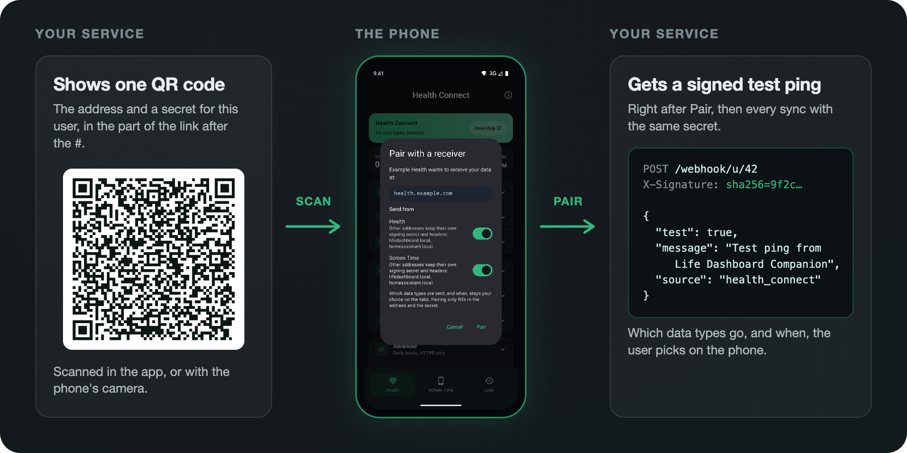
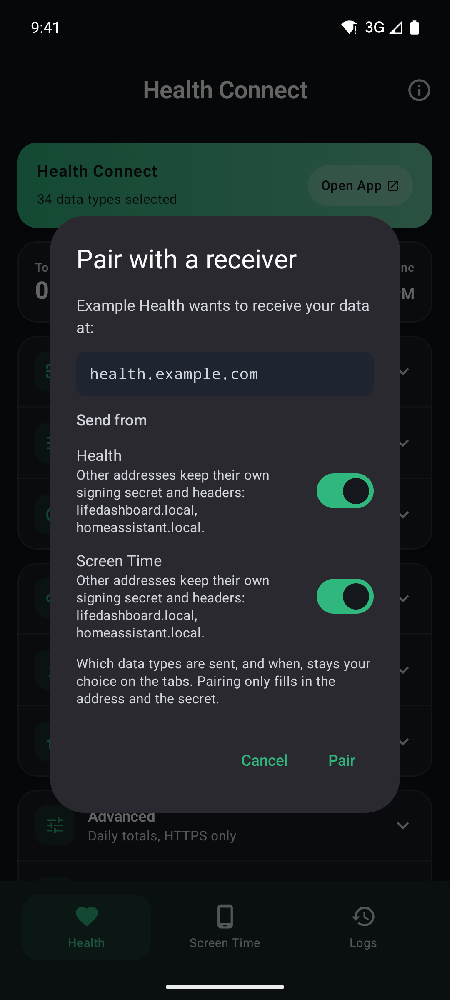

# Pairing your own receiver by QR code

Your service can let its users connect Life Dashboard Companion the way the Home Assistant integration does: it shows one QR code, the user scans it and taps **Pair**, and the app fills in your webhook address and a signing secret for that user. Nobody types a URL or copies a secret, and you know it worked because the app posts a signed test ping right away.

<p align="center">
  
</p>

A pairing code is just a link. This page is the whole format, so you can build one in any language without a library from us. The [Home Assistant integration](https://github.com/owen282000/life-dashboard-ha/blob/main/custom_components/life_dashboard/pairing.py) and the [Life Dashboard Stack](https://github.com/owen282000/life-dashboard-stack) generate exactly these links.

## Contents

- [What a code can and cannot do](#what-a-code-can-and-cannot-do)
- [The link](#the-link)
  - [Fields](#fields) - [Encoding](#encoding) - [Why the fragment](#why-the-fragment)
- [Build a code](#build-a-code)
  - [Python](#python) - [Node.js](#nodejs) - [Known-good test vector](#known-good-test-vector)
- [What happens on the phone](#what-happens-on-the-phone)
- [After Pair: the test ping](#after-pair-the-test-ping)
- [When a code is refused](#when-a-code-is-refused)
- [iPhone](#iphone)
- [Security checklist](#security-checklist)
- [Try it](#try-it)

## What a code can and cannot do

A code carries an address and a secret, and nothing else that changes what the phone does.

- **It fills in one webhook address and the secret to sign with**, in the sections you allow (Health, Screen Time, or both). The user can still switch a section off in the dialog.
- **It never picks data types or a schedule.** Which data is sent, and how often, stays the user's choice on the app's tabs. A code cannot quietly start sending someone's heart rate anywhere.
- **It never touches other receivers.** Every other address keeps its own secret and headers, and the dialog lists them. An address added by pairing starts without custom headers, so an API key typed for another receiver never follows a scanned code.
- **Nothing is saved until the user taps Pair.**

## The link

A code is an https link with everything in the part after the `#`:

```
https://owen282000.github.io/life-dashboard-companion-app/pair#v=1&url=<address>&secret=<secret>&name=<name>&sources=<sources>
```

The app also opens the same payload behind its own scheme:

```
lifedashboard://pair#v=1&url=<address>&secret=<secret>
```

Use the https form for a QR code. The phone's camera opens it straight into the app on Android, because Android checks the link against the app's signing certificate, and without the app installed it opens a [page](https://owen282000.github.io/life-dashboard-companion-app/pair) that says where to get it. The `lifedashboard://` form is for a button on a web page that is already open on the phone; it does nothing without the app.

### Fields

| Field | Required | Value |
|---|---|---|
| `v` | yes | `1`, the format version. Anything else is refused with "This code was made by a newer version". |
| `url` | yes | The webhook address the app posts to, `https://` or `http://`. At most 2048 characters, with no spaces and no comma. |
| `secret` | yes | The HMAC signing secret, used as text. At most 512 characters, no spaces. |
| `name` | no | What the dialog calls your service: "Example Health wants to receive your data at". Control characters are removed and it is cut at 64 characters. Without it, the dialog says "A receiver wants your data at". |
| `sources` | no | Which sections your receiver accepts, comma separated: `health_connect`, `screen_time`. Unknown values are ignored. Leave it out to accept both. |

The order of the fields does not matter, and fields the app does not know are ignored, so a newer generator can add one without breaking older apps.

### Encoding

Percent-encode every value completely, including `:`, `/`, `&`, `=`, `+` and `,`. Python's `quote(value, safe="")` and JavaScript's `encodeURIComponent(value)` both do this.

- The app splits the fragment on `&` and `=` first and decodes each part after. An address with a query string such as `?user=42&key=abc` therefore survives, as long as its `&` and `=` are encoded.
- A space is `%20`. Do not use form encoding (`URLSearchParams`, or `urlencode` without `quote_via=quote`), which turns a space into `+`: the app reads a `+` as a plus sign, because a secret can contain one.
- The commas between `sources` are encoded too: `health_connect%2Cscreen_time`.

### Why the fragment

A browser never sends the part after the `#` to a server ([RFC 3986, section 3.5](https://www.rfc-editor.org/rfc/rfc3986#section-3.5)). When a code is scanned on a phone without the app, the landing page loads, but the secret in the fragment stays on that phone and never reaches GitHub Pages or anyone's logs.

## Build a code

Give every user their own address or their own secret, so one user's code cannot sign data for another. Generate the secret on your server and store it with the user.

### Python

Standard library only for the link. [segno](https://pypi.org/project/segno/) turns it into a QR code.

```python
import secrets
from urllib.parse import quote, urlencode

import segno

PAIR_PAGE = "https://owen282000.github.io/life-dashboard-companion-app/pair"


def pairing_link(webhook_url, secret, name=None, sources=None):
    fields = {"v": "1", "url": webhook_url, "secret": secret}
    if name:
        fields["name"] = name
    if sources:
        fields["sources"] = ",".join(sources)
    # quote with safe="" encodes every reserved character, so a & or = inside the
    # address can never end a field early, and a space becomes %20, never +.
    return PAIR_PAGE + "#" + urlencode(fields, quote_via=quote, safe="")


secret = secrets.token_urlsafe(32)  # store this with the user
link = pairing_link(
    "https://health.example.com/webhook/u/42",
    secret,
    name="Example Health",
    sources=["health_connect"],
)
segno.make(link, error="m").save("pairing.svg", scale=6, border=4)
```

### Node.js

`encodeURIComponent` for the link, the [qrcode](https://www.npmjs.com/package/qrcode) package for the image.

```js
import crypto from "node:crypto";
import QRCode from "qrcode";

const PAIR_PAGE = "https://owen282000.github.io/life-dashboard-companion-app/pair";

function pairingLink(webhookUrl, secret, { name, sources } = {}) {
  const fields = [["v", "1"], ["url", webhookUrl], ["secret", secret]];
  if (name) fields.push(["name", name]);
  if (sources) fields.push(["sources", sources.join(",")]);
  // Not URLSearchParams: that writes a space as +, which the app reads as a plus sign.
  return PAIR_PAGE + "#" + fields.map(([k, v]) => `${k}=${encodeURIComponent(v)}`).join("&");
}

const secret = crypto.randomBytes(32).toString("base64url"); // store this with the user
const link = pairingLink("https://health.example.com/webhook/u/42", secret, {
  name: "Example Health",
  sources: ["health_connect"],
});

// A data: URL for an , or QRCode.toString(link, { type: "svg" }) for inline SVG.
const dataUrl = await QRCode.toDataURL(link, { errorCorrectionLevel: "M", margin: 4 });
```

For the QR code itself, error correction M and a quiet zone of four modules scan well from a laptop screen. Show it at least 4 cm (about 250 CSS pixels) wide, dark on light. A link with a 64 character secret makes a version 10 code, which every phone camera reads.

### Known-good test vector

These inputs must give exactly this link. The app's own tests ([PairingLinkTest](../app/src/test/java/com/owen282000/lifedashboard/PairingLinkTest.kt)) and the Home Assistant integration's tests check the same string, so it is a good unit test for your generator.

| Input | Value |
|---|---|
| `url` | `http://192.168.10.138:8123/api/webhook/` followed by 64 times `a` |
| `secret` | 64 times `b` |
| `name` | `Home Assistant` |
| `sources` | `health_connect`, `screen_time` |

```
https://owen282000.github.io/life-dashboard-companion-app/pair#v=1&url=http%3A%2F%2F192.168.10.138%3A8123%2Fapi%2Fwebhook%2Faaaaaaaaaaaaaaaaaaaaaaaaaaaaaaaaaaaaaaaaaaaaaaaaaaaaaaaaaaaaaaaa&secret=bbbbbbbbbbbbbbbbbbbbbbbbbbbbbbbbbbbbbbbbbbbbbbbbbbbbbbbbbbbbbbbb&name=Home%20Assistant&sources=health_connect%2Cscreen_time
```

## What happens on the phone



The user scans your code in the app (**Scan a pairing code** in the setup, or on the **Webhook** card of the Health or Screen Time tab) or with the phone's camera. Both end in the same dialog:

- **Your name and your host.** "Example Health wants to receive your data at `health.example.com`". The host is taken from `url`, so a code cannot claim to be one address and send to another.
- **Send from.** A switch per section your `sources` allows, both on. Under each, which other addresses keep their own secret, or that this address is already there and only its secret changes.
- **Plain HTTP.** For an `http://` address, a switch that allows plain HTTP, which the app refuses by default.
- **Pair** saves the address and the secret, then sends the test ping. **Cancel** saves nothing.

Scanning the same code again replaces only the secret of that address. Scanning a code with a new secret is how a user rotates it.

<br clear="right">

## After Pair: the test ping

Right after **Pair**, the app posts one test ping to your address, signed with the secret from the code. It is the same ping as the **Test ping** button ([reference](webhook.md#test-ping)):

```http
POST /webhook/u/42 HTTP/1.1
Content-Type: application/json; charset=utf-8
X-Signature: sha256=<hex of HMAC-SHA256(secret, raw body)>

{
  "test": true,
  "message": "Test ping from Life Dashboard Companion",
  "timestamp": "2026-10-04T12:00:00Z",
  "app_version": "1.29.0",
  "source": "health_connect"
}
```

There is one ping, also when both sections were paired. `source` is `health_connect` when the Health section was paired and `screen_time` when only Screen Time was. The iPhone app sends `"source": "healthkit_ios"`.

Verify the signature over the raw body, before you parse it, exactly as for real payloads ([Verifying the signature](webhook.md#verifying-the-signature)). In Python:

```python
import hashlib
import hmac


def signature_ok(raw_body: bytes, header: str, secret: str) -> bool:
    expected = "sha256=" + hmac.new(secret.encode(), raw_body, hashlib.sha256).hexdigest()
    return hmac.compare_digest(expected, header or "")
```

Then answer with any `2xx`, and the user sees "Paired with health.example.com, test ping delivered". Anything else, or no answer, gives "Paired with health.example.com, but the test ping failed" with the reason, such as the HTTP status. Answer a bad signature with `401`, as for every other request.

A ping carries no data, so do not store it as a measurement. It is a good moment to mark the user as connected on your side. The pairing stays in place when the ping fails, so a user can fix the address or the network and tap **Test ping** later.

From then on every sync is signed with the same secret. [The webhook reference](webhook.md) describes every payload.

## When a code is refused

| The app says | Cause |
|---|---|
| "That is not a Life Dashboard pairing code." | Not one of the two link shapes. The scanner keeps looking. |
| "This code was made by a newer version. Update the app and scan again." | `v` is not `1`. |
| "This code is missing its address or its secret." | No `url` or `secret`, an address that is not a valid `http://` or `https://` URL, or one with a space or a comma, or a value over its limit. |
| "This receiver does not accept anything this app can send." | `sources` names nothing the app knows. |

## iPhone

[Life Dashboard Companion for iPhone](https://github.com/owen282000/life-dashboard-companion-app-ios) reads the same links, with three differences.

- **Health only.** iOS has no screen time to send, so a code must accept `health_connect`: leave `sources` out, or include it.
- **Plain HTTP only to a home network.** iOS fixes which `http://` addresses an app may reach. A private IP address (`192.168.x.x`, `10.x.x.x`, `172.16.x.x` to `172.31.x.x`, `100.64.x.x` to `100.127.x.x` for Tailscale, loopback, link local), a `.local` name, or a name without a dot work. Plain HTTP to a name such as `ha.lan` is refused by iOS on every request, and the sheet says so before anything is saved. Use https and the problem is gone.
- **The camera opens the page first.** The iPhone camera opens the https link in Safari, and the page shows an **Open in the app** button that hands the code to the app through `lifedashboard://`. Scanning inside the app skips that step.

## Security checklist

- **One secret per user**, generated on your server with a cryptographic random generator, at least 32 bytes.
- **Show the code only to that user**, after they signed in. Anyone who sees it can sign data as them.
- **Never log the link or the fragment.** It contains the secret. The fragment is not in your web server's access log by design; keep it out of your application logs too.
- **Verify every request**, not only the test ping, and answer 401 to a bad signature.
- **Use https.** Plain HTTP is for a receiver on the user's own network.
- **Let users rotate.** A new secret means a new code; scanning it replaces the old secret on the phone.

## Try it

Scan this code with a phone that has the app. It opens the dialog for Example Health; tap **Cancel**, because `health.example.com` does not exist.

<p align="center">
  
</p>

On an emulator or a phone with USB debugging, adb opens the same link:

```sh
adb shell am start -a android.intent.action.VIEW \
  -d "'https://owen282000.github.io/life-dashboard-companion-app/pair#v=1&url=https%3A%2F%2Fhealth.example.com%2Fwebhook%2Fu%2F42&secret=example-secret-not-real-0123456789&name=Example%20Health'"
```

To see the test ping and every payload after it before you write a receiver, run [webhook-receiver.py](../scripts/webhook-receiver.py) on a laptop and pair with a code that points at it.
